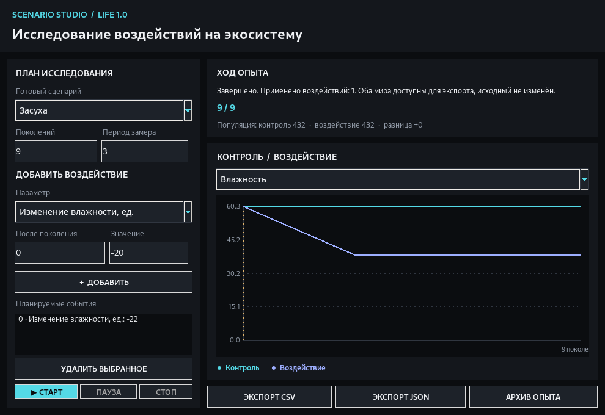

# Life

**Life 1.0.1** — исследовательская песочница клеточных автоматов и синтетических экосистем. Проект развивается как настольный инструмент: можно построить мир, наблюдать за его развитием, сравнивать эксперименты и сохранять воспроизводимые результаты. Интерфейс, документация и управление — на русском языке.



[Скачать последнюю версию](https://github.com/Onmaynec/Life/releases/latest) · [История изменений](CHANGELOG.md) · [Как устроена модель](docs/MODEL.md) · [Руководство по сценариям](docs/SCENARIOS.md)

## Установка и запуск

**Windows:** скачать архив исходников из [Releases](https://github.com/Onmaynec/Life/releases), распаковать и запустить `START_WINDOWS.bat` (нужен Python 3.10+). Для 1.0.1 GitHub Actions также собирает **Windows x64 ZIP с `Life.exe`** и встроенными библиотеками. Он публикуется отдельным файлом релиза только после автоматических тестов и запуска упакованного приложения; последующая проверка на обычных Windows 10/11 остаётся обязательной. Не извлекайте один `.exe` из папки: рядом должны оставаться файлы `_internal`.

**Из исходников (Windows, Linux):**

```bash
python -m pip install -r requirements.txt
python main.py
```

Для проверки установки: `python main.py --smoke-test` (без окна) или `python main.py --ui-smoke-test` (проверяет запуск графики и двух независимых сценариев). Подробности по установке и проверке Windows — в [WINDOWS.md](docs/WINDOWS.md).

## Основные возможности

| Раздел | Что можно исследовать |
| --- | --- |
| Клеточный автомат | Оригинальная «Игра Жизнь» Конвея, другие правила B/S, границы, структуры RLE, пошаговое выполнение, редактор поля |
| Экосистема | Растения, травоядные и хищники, энергия, ресурсы почвы, климат, конкуренция и наследуемые параметры |
| Родословные | ID организма, предки, основатели, причины смерти, распределения генов и карты семей |
| Наблюдения | История поколений, численность, генетика, ресурсы, оповещения и экспорт CSV |
| Визуализация | 8 тёмных интерфейсных тем, 10 палитр поля, стили клеток, 2D/3D-слои, мини-карта |
| Experiment Lab | Серии независимых опытов, одинаковые seed, статистика, сравнение архивов JSON |
| **Scenario Studio (1.0.0)** | Контрольный мир и мир с воздействием, сценарии засухи, ливней, восстановления почвы и загрязнения, графики и переносимый ZIP-архив опыта |
| Сохранение | `.lifelab`, атомарная запись, автосохранение, восстановление сессии и ручная контрольная точка |

**Важно:** экосистема — учебная модель с упрощёнными правилами. Полученные результаты не являются доказательством биологических закономерностей или прогнозом природной среды. 3D-графики визуализируют измерения двумерного поля, а не превращают его в физический трёхмерный мир.

## Scenario Studio — новинка 1.0.0

1. Переключиться в режим **«Экосистема»**. При необходимости включить расширенные параметры среды.
2. Открыть **«Сценарии»** в верхней панели или нажать `Ctrl+Shift+E`.
3. Выбрать один из шести шаблонов либо собрать собственную последовательность воздействий (до 32 на опыт).
4. Задать 1–1000 поколений и интервал измерений, запустить две независимые копии мира.
5. Сравнить графики контроля и воздействия, экспортировать CSV/JSON или **«Архив опыта»** с исходным состоянием, двумя итоговыми мирами и SHA-256.

Исходный открытый мир не затрагивается. Обе копии начинают с одинаковыми клетками, генами, родословными и состоянием генератора случайных чисел. Результат воздействия не считается причинным доказательством для реальной природы — это сравнение внутри модели. [Подробное руководство](docs/SCENARIOS.md).

## Управление

| Действие | Клавиша или мышь |
| --- | --- |
| Запустить / пауза | `Пробел` |
| Один шаг | `N` |
| Камера | Зажатая ПКМ или СКМ, колесо — масштаб |
| Создать/стереть клетки | ЛКМ, кисть и ластик |
| Левая и правая панели | `F6` / `F7`, обе панели — `F10` |
| Полный экран | `F11` |
| Снимок и восстановление | `F8` / `F9` |
| Серии опытов | `Ctrl+E` |
| Парные сценарии | `Ctrl+Shift+E` |
| Сохранить / открыть | `Ctrl+S` / `Ctrl+O` |

В узком окне и при увеличенном DPI часть панелей скрывается автоматически; вернуть её можно через `F6` и `F7`. Дополнительные команды доступны через верхние кнопки. Подробный список действий — в справке `F1`.

## Форматы и совместимость

- `.lifelab` — сжатое сохранение симуляции (формат **5**). Включает состояние RNG, генетику, родословные и измерения; загрузка файлов версий 1–4 поддерживается. При миграции из старых миров неизвестные предки не восстанавливаются.
- `.rle` — структуры классического клеточного автомата, **без** генетики и ресурсов.
- `.json`, `.csv` и `.md` — результаты исследований, не файлы мира.
- `Life Scenario ZIP` — отдельный пакет с тремя `.lifelab`, отчётом, CSV и `manifest.json`. Проверить архив: `python -m life_lab.scenarios путь/к/архиву.zip`.

Импорт `.lifelab` ограничен по числу и размеру элементов архива, не использует `pickle`. [Описание форматов и безопасности](docs/SECURITY.md).

## Документация

- [Архитектура и модули](docs/ARCHITECTURE.md)
- [Правила и ограничения экосистемы](docs/MODEL.md)
- [Исследовательские инструменты](docs/RESEARCH.md), [серии опытов](docs/EXPERIMENTS.md), [Scenario Studio](docs/SCENARIOS.md)
- [Родословные](docs/LINEAGE.md), [лента событий](docs/TIMELINE.md), [показатели производительности](docs/PERFORMANCE.md)
- [Оформление интерфейса](docs/VISUALS.md), [восстановление](docs/RECOVERY.md)
- [Проверка и тестирование](docs/TESTING.md), [Windows-сборка](docs/WINDOWS.md)
- [График дальнейших задач](docs/ROADMAP.md), [ведение Issues](docs/ISSUES.md), [подготовка релиза](docs/RELEASING.md)

## Разработка

Проект использует Python, NumPy, Pillow, Matplotlib и стандартный Tkinter. Основная симуляция не зависит от Tkinter: движок и исследовательские расчёты можно тестировать без окна.

```bash
python -m unittest discover -s tests -v
python tools/benchmark.py
python tools/benchmark_spatial.py
```

Новые функции и регрессионные исправления должны сопровождаться проверками и точными заметками в [CHANGELOG.md](CHANGELOG.md). [Правила участия](CONTRIBUTING.md). У проекта нет встроенных рекламных или облачных сервисов; файлы исследований остаются локальными.
