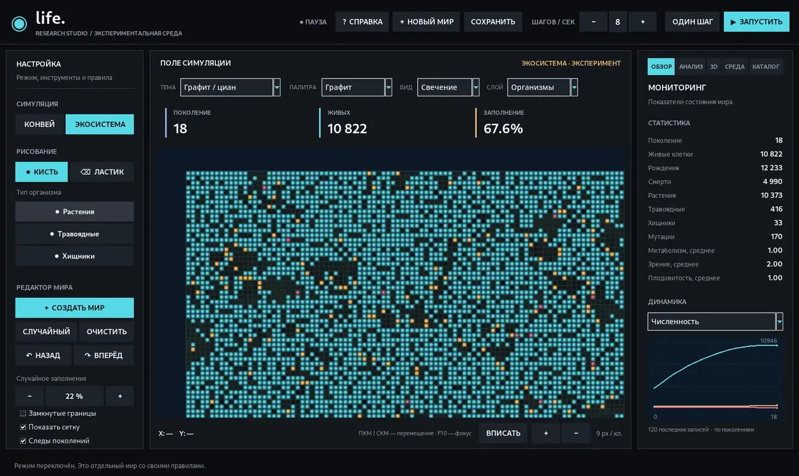
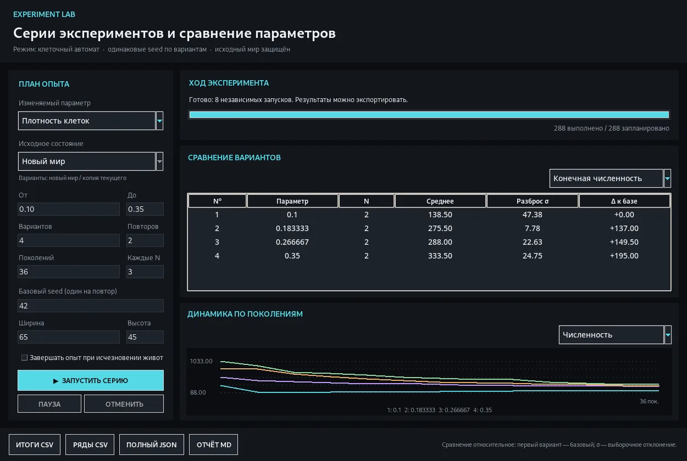
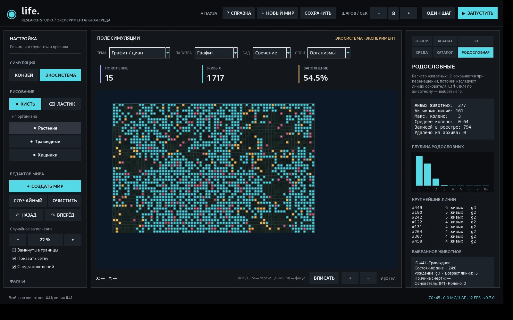

# Life

**Life** — настольная лаборатория клеточных автоматов и экспериментальных экосистем на Python. Слева находятся правила и редактор, по центру — мир, справа — исследовательские инструменты. Классическая «Жизнь» Конвея и модель экосистемы — независимые режимы.

**Текущая версия: v0.7.0 — Evolution & Lineage.** [История изменений](CHANGELOG.md) · [Как устроена модель](docs/MODEL.md) · [Исследовательские инструменты](docs/RESEARCH.md) · [Родословные](docs/LINEAGE.md)



[3D-пространственные измерения](docs/images/life-0.5.0-3d.webp)





## Что нового в v0.7.0 — Evolution & Lineage

У животных появился постоянный **ID**, который сохраняется при перемещении, отдельный ID родителя и основателя, поколение рождения, глубина родословной и количество потомков. При гибели животного причина и поколение остаются в журнале. Новая вкладка **«Родословная»** показывает активные линии, распределение глубины и цепочку предков выбранного животного. Чтобы выбрать организм на поле без редактирования, используйте **Ctrl+ЛКМ**.

Новые показатели доступны на вкладке «Анализ» и в CSV, а глубину родословной можно изучать в 3D. Реестр экспортируется отдельно в CSV. Сохранения повышены до формата 5; миры предыдущих версий открываются, но история происхождения до загрузки неизвестна, поэтому их живые животные становятся основателями. Подробности — в [руководстве по родословным](docs/LINEAGE.md).

Классическая «Жизнь» Конвея и правила наследования трёх существовавших генов не изменены. Появился инструмент **наблюдения за эволюцией**, а не новая биологическая модель.

## Что нового в 0.6.0 — Experiment Lab

Теперь можно запускать **серии независимых экспериментов**, а не сравнивать только два состояния одного мира. Откройте **Анализ → Серии экспериментов** или нажмите `Ctrl+E`. В отдельном окне настраивается изучаемый параметр, диапазон значений, число повторов, длительность наблюдения, seed и размер мира. Для экосистемы можно исследовать климатические параметры на **копии текущего мира**.

В серии используется одинаковый набор начальных seed для вариантов. После завершения каждого запуска появляется строка результатов; справа отображается график динамики, усреднённой по повторам. Доступны пауза, отмена, ранняя остановка при исчезновении животных и экспорт в CSV, JSON и Markdown. Оригинальный мир не изменяется.

Встроенная таблица показывает среднее, стандартное отклонение и попарную разницу относительно первого варианта. Данные сохраняются с планом опыта: их можно проверить или открыть в других программах. **Это экспериментальная модель, а не научно валидированный биологический прогноз.** Подробные параметры и методика — в [руководстве по экспериментам](docs/EXPERIMENTS.md).


## Что нового в 0.5.0

Главное изменение — возможность не только наблюдать за симуляцией, но и проводить сравнимые эксперименты. Интерфейс переведён на нейтральные тёмные поверхности с четырьмя акцентными схемами. На Windows для стандартной рамки окна запрашивается тёмный заголовок через DWM; без поддержки этого атрибута остаётся системное оформление. Рабочее поле можно масштабировать колесом, а **зажатая ПКМ или СКМ теперь перемещает камеру**, не стирая клетки.

В v0.5.0 справа были добавлены пять вкладок (в v0.7.0 к ним добавилась «Родословная»):

- **Обзор:** живые показатели, динамика, мини-карта, инспектор и оформление мира.
- **Анализ:** пространственные показатели, графики истории, контрольное поколение и сравнение с ним, экспорт CSV и Markdown-отчёта, остановка при исчезновении вида.
- **3D:** пространственные данные в виде изометрического предпросмотра и отдельной интерактивной студии Matplotlib; столбцы, поверхность, каркас, вращение, масштабирование, сохранение PNG.
- **Среда:** климатические процессы и жизненные циклы, интенсивность осадков, температурный фон, перенос влаги и минералов. Процессы включаются независимо и относятся только к экосистеме.
- **Каталог:** 25 готовых фигур Конвея, повороты, отражения, установка в центр, сдвиг мира.

Над миром появился выбор **2D-слоя**: организмы, минералы, влага, энергия, возраст, рельеф, органика, токсины. Шкалы фиксированы по единицам модели, чтобы изменение картины между поколениями имело смысл. Все данные читаются непосредственно из массивов симуляции.

В интерфейсе появились плавная подсветка кнопок при наведении и индикатор работы. Анимации оформления не изменяют скорость и правила моделей и не сохраняются в файл мира.

## Два режима

### Классическая «Жизнь»

По умолчанию используется `B3/S23`. Можно переключить правило на HighLife, Seeds, Day & Night, Maze, Replicator либо ввести своё B/S. Клетки обновляются одновременно. Доступны замкнутые границы, редактор кистью, ластик, штампы, импорт/экспорт RLE, отмена редактирования и PNG.

Каталог содержит устойчивые фигуры, осцилляторы, космические корабли, долгоживущие конфигурации и составные примеры. Фигуры можно поворачивать на 90° в обе стороны, на 180°, отражать и ставить на карту.

### Экосистема

Упрощённый виртуальный мир состоит из растений, травоядных и хищников. У животных есть энергия и наследуемые признаки — метаболизм, зрение и плодовитость. Животные ищут пищу, размножаются и мутируют; растения используют минеральные ресурсы. Для наблюдения доступны отдельные показатели каждого вида.

В v0.5.0 добавлена **расширенная среда**: влажность, рельеф, минеральные ресурсы, органическое вещество, семенной банк, токсичные отходы, старение, сезоны, суточное освещение, температура, осадки и локальные взаимодействия. Вкладка «Среда» позволяет включать процессы по отдельности и менять их интенсивность. При создании нового мира через интерфейс расширенная среда включается; старые миры открываются с прежними правилами, пока её не активировать вручную.

Это **исследовательская игрушечная модель**, а не биологический или климатический прогноз. Смысл параметров и список процессов приведены в [документации модели](docs/MODEL.md).

## Установка

**Python 3.10+**. На Windows распакуйте архив релиза и откройте `START_WINDOWS.bat`. Скрипт проверит наличие библиотек и установит недостающие. Без установленного Python `.bat` не запустит программу.

Для запуска вручную:

```bash
python -m pip install -r requirements.txt
python main.py
```

Используются NumPy, Pillow, Matplotlib и Tkinter из обычной установки Python. После установки зависимостей приложение работает локально; подключение к сервисам не требуется. Готовый отдельный Windows EXE пока не выпускается.

## Управление

| Действие | Управление |
|---|---|
| Пуск / пауза | `Пробел` |
| Следующее поколение | `N` |
| Изменить карту | ЛКМ с выбранной кистью или ластиком |
| **Перемещать камеру** | **Зажать ПКМ / СКМ**, либо Shift + ЛКМ |
| Масштаб | Колесо мыши |
| Вписать мир | `F` |
| Полноэкранный режим | `F11` |
| Режим только с игровым полем | `F10` |
| Следующая исследовательская вкладка | `Ctrl+Tab` |
| **Открыть серии экспериментов** | **`Ctrl+E`** |
| Сетка | `G` |
| Случайное заполнение / очистка | `R` / `C` |
| Отменить / вернуть редактирование | `Ctrl+Z` / `Ctrl+Y` |
| Сохранить / открыть | `Ctrl+S` / `Ctrl+O` |
| Справка | `F1` |

ПКМ намеренно **больше не стирает** клетки. Для удаления выберите инструмент «Ластик» и используйте ЛКМ. В правой панели вкладка «Каталог» управляет трансформациями фигур и сдвигом мира.

## Сохранения и воспроизводимость

`.lifelab` — сжатый файл с массивами и параметрами мира. В формате 4 сохраняются карты влажности, возраста, рельефа, семян, органики и токсинов, конфигурация среды и отдельный журнал исследовательских измерений. Сохранения форматов 1–3 можно открыть. Старые миры **не получают новые правила незаметно**.

В пределах одной версии состояние генератора случайных чисел хранится вместе с миром; продолжение после загрузки воспроизводится при тех же настройках. Исследовательский журнал содержит до 2 000 измерений; основной журнал поколений — до 10 000. Измерения не меняют состояние клеток.

Смена режима, создание нового мира и очистка заменяют текущую ситуацию. Сначала сохраните её, если нужна для исследования. Undo/Redo относится к редактированию, не к прошедшим поколениям. История отдельных серий Experiment Lab сохраняется только при экспорте; она не встраивается в `.lifelab`.

## Разработка

```bash
python -m unittest discover -s tests -v
```

Основные файлы: `experiment_suite.py` — алгоритм серий и экспорт, `experiment_ui.py` — отдельное окно сравнения, `world.py` — правила мира, `ecology.py` — расширенная среда, `instruments.py` — измерения, `research_ui.py` — вкладки и 3D, `visuals.py` — отрисовка, `chrome.py` — оформление рамки Windows, `storage.py` — сохранения, `patterns.py` и `pattern_tools.py` — фигуры и редактор.

Порядок проверки интерфейса описан в [docs/TESTING.md](docs/TESTING.md), архитектура — в [docs/ARCHITECTURE.md](docs/ARCHITECTURE.md), план — в [docs/ROADMAP.md](docs/ROADMAP.md). Баги и предложения — в [Issues](https://github.com/Onmaynec/Life/issues).

### Известные ограничения

Большие миры с большим числом животных замедляют модель: поиск пищи пока выполняется по отдельным организмам. Пространственный анализ кластеров затратнее простых счётчиков. 3D-графики рассчитаны по усреднённым блокам (ограничение плотности сетки), поэтому это обзор структуры данных, а не отдельная физическая трёхмерная симуляция. Тёмный нативный заголовок зависит от версии и настроек Windows; разные DPI и Windows 10/11 нуждаются в дополнительной проверке на реальных устройствах.
