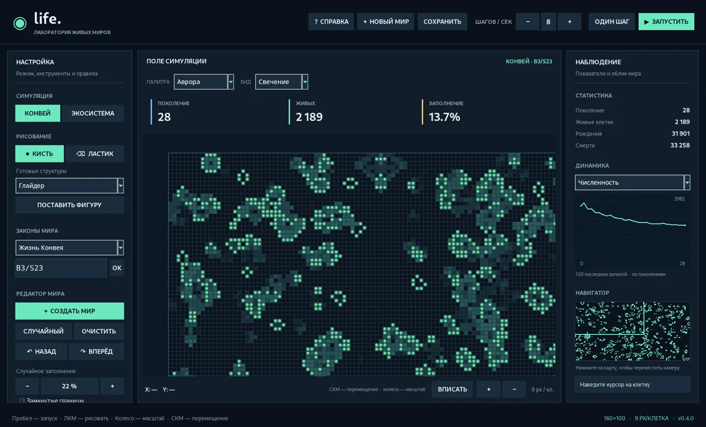

# Life

**Life** — настольная песочница на Python для экспериментов с клеточными автоматами и простыми экосистемами. Проект начался с «Игры Жизнь» Конвея, но классический автомат и модель живого мира здесь работают независимо.

Текущая версия: **v0.4.0**. История изменений — в [CHANGELOG.md](CHANGELOG.md).



[Посмотреть экосистему](docs/images/life-0.4.0-ecosystem.webp)

## Новый интерфейс v0.4.0

Главное окно разделено на три области: настройки и инструменты слева, мир по центру, статистика и наблюдение справа. Над полем расположены основные показатели эксперимента, выбор палитры и способа отрисовки.

- **Три палитры:** «Аврора», «Биосфера» и «Ультрафиолет».
- **Три стиля:** «Свечение» с мягким светом клеток, «Мозаика» с отдельными плитками и «Схема» с обычными цветными клетками. При малом масштабе детальная отрисовка отключается ради читаемости и скорости.
- **Мини-карта:** показывает расположение клеток и область камеры. Нажмите на нужное место для перемещения.
- **Инспектор:** наведите курсор на клетку, чтобы увидеть её тип, координаты, а в экосистеме — параметры почвы и организма.
- **Графики:** линии численности и генетических признаков с сеткой, подписанными поколениями и маркерами последней точки.
- **Настройки вида:** палитра, стиль, сетка, следы и скорость запоминаются между запусками локально. Они не входят в `.lifelab` и не меняют симуляцию.
- **Подсказки:** `F1` открывает короткую справку по двум режимам и управлению.

Отрисовка выполнена на Pillow поверх Tkinter и может требовать больше времени при крупном масштабе и большой плотности клеток. Отдельная задача по производительности экосистемы остаётся открытой.


## Что есть сейчас

### Классическая «Жизнь»

- Правила B3/S23 и ещё пять известных наборов, включая HighLife и Seeds. Можно вписать своё правило формата `B36/S23`.
- Живые клетки обновляются одновременно; доступны обычные и замкнутые границы.
- Готовые фигуры: глайдер, лёгкий космический корабль, R-пентамино, пульсар, пушка Госпера.
- Импорт/экспорт RLE, следы предыдущих поколений, управление скоростью.

### Создание мира

Кнопка **«Создать мир»** открывает настройки нового эксперимента:

- Классический автомат или экосистема, размер от 20×20 до 700×500 клеток.
- Обычные или замкнутые границы; в классическом режиме — собственное правило B/S и плотность заполнения.
- В экосистеме — плотности растений, травоядных и хищников в процентах от всей площади. Значения не обязаны суммарно давать 100%: оставшиеся клетки будут пустыми.
- Необязательный **seed**: один и тот же seed с теми же параметрами создаёт одинаковый стартовый мир. Без seed каждый новый мир может отличаться.

**Важно:** создание и переключение режима заменяют текущий мир. Если эксперимент нужен, сначала сохраните его.

### Экосистема

- Растения используют питательные вещества почвы, травоядные поедают растения, хищники охотятся на травоядных.
- Организмы двигаются, теряют энергию, размножаются и погибают. Мир можно заселить вручную или случайным образом.
- **Эволюционные признаки.** Животные наследуют скорость расходования энергии, дальность зрения и плодовитость. Каждый признак может немного меняться при рождении потомка.
- **Поиск пищи.** Животные замечают пищу на расстоянии до трёх клеток и двигаются в её сторону по одному шагу за поколение.
- **Цена способностей.** Улучшенная видимость и высокая плодовитость повышают расход энергии; универсально лучшего набора признаков нет.
- **Аналитика.** Панель показывает общие средние значения генов. В истории и CSV они также считаются отдельно для травоядных и хищников.
- **История.** Можно переключать график численности, метаболизма, зрения и плодовитости, а затем экспортировать данные в CSV. Непредставленные виды в CSV имеют пустые значения средних генов.
- **Сохранения.** В `.lifelab` сохраняется журнал последних 10 000 записей; графики показывают 120 последних. После загрузки мира версии 1 или 2 журнал начинается с текущего поколения.
- **Совместимость.** Сохранения версий 1 и 2 открываются автоматически; отсутствующие гены получают стандартные значения.
- На панели видна численность видов, рождения, смерти и история популяций.

### Инструменты

Редактор клеток, масштабирование и перемещение камеры, отмена правок, сохранения `.lifelab`, экспорт PNG и CSV, работа без интернета после установки зависимостей. При вводе в текстовые поля игровые горячие клавиши не срабатывают.

## Установка и запуск

Нужен **Python 3.10+**. На Windows можно запустить `START_WINDOWS.bat` из распакованной папки: скрипт проверит NumPy и Pillow, установит их при необходимости и откроет окно программы.

Запуск вручную:

```bash
python -m pip install -r requirements.txt
python main.py
```

Для работы интерфейса нужен Tkinter (обычно входит в установку Python для Windows). Сама симуляция работает локально, без регистрации и подключения к серверам.

## Управление

| Действие | Клавиша или мышь |
| --- | --- |
| Создать мир с параметрами | Кнопка «Создать мир» |
| Открыть справку | `F1` или «Справка» |
| Настроить палитру и вид клеток | Списки над картой |
| Переместить камеру по мини-карте | ЛКМ на мини-карте |
| Запустить / остановить симуляцию | `Пробел` |
| Один шаг | `N` |
| Случайное заполнение | `R` |
| Очистка мира | `C` |
| Показать / скрыть сетку | `G` |
| Вписать поле в окно | `F` |
| Рисование / стирание | ЛКМ / ПКМ |
| Перемещение камеры | СКМ или Shift + ЛКМ |
| Масштаб | Колесо мыши |
| Выбрать вид в экосистеме | `1`, `2`, `3` |
| Отмена / повтор правки | `Ctrl+Z` / `Ctrl+Y` |
| Сохранить / открыть мир | `Ctrl+S` / `Ctrl+O` |

## Устройство проекта

```text
main.py                 Точка входа
life_lab/app.py         Окно, управление, графики и навигатор
life_lab/visuals.py     Палитры и отрисовка клеток без зависимостей от окна
life_lab/preferences.py Локальные настройки отображения
life_lab/world.py       Правила клеточного автомата и экосистемы
life_lab/patterns.py    Готовые фигуры, импорт и экспорт RLE
life_lab/storage.py     Сохранения .lifelab
life_lab/genetics.py    Наследование и выбор направления движения
life_lab/setup.py       Проверка параметров и создание новых миров
life_lab/history.py     История эксперимента, показатели видов, CSV

tests/                  Проверки игровых правил и файлов
```

Проверки запускаются без игрового окна:

```bash
python -m unittest discover -s tests -v
```

## Ограничения

По умолчанию размер мира — 160×100. На больших картах до 700×500 клеток работа экосистемы может замедляться. На густонаселённых больших картах экосистема может работать медленно: животные обрабатываются последовательно. Отмена и повтор относятся к редактированию, а не к уже прошедшим поколениям. Переключение режима создаёт новый мир.

Экосистема — экспериментальная модель, а не реконструкция настоящей биологической эволюции. Здесь нет полноценной ДНК, клеточного метаболизма или обучения.

Задачи и известные ограничения записаны в [Issues](https://github.com/Onmaynec/Life/issues). Планы развития — в [docs/ROADMAP.md](docs/ROADMAP.md).

